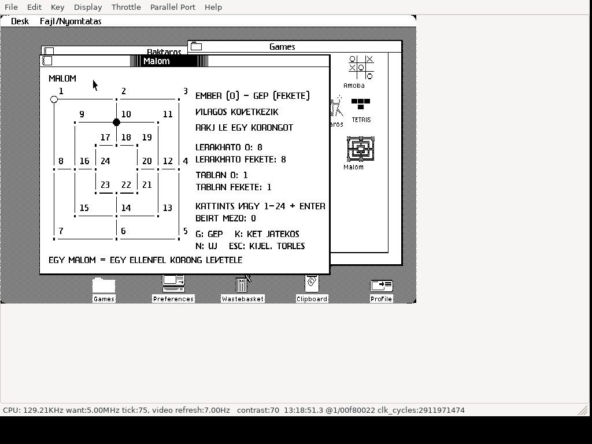

# Malom (Nine Men’s Morris) for Apple Lisa 2

**Native game for real Apple Lisa 2 hardware running Lisa Office System 3,
including Lisa 2/5 and Lisa 2/10.** The release is a native Motorola 68000 LOS
application. LisaEm is also supported.

Hungarian, windowed Nine Men’s Morris: play against the computer or another
person, using the mouse or numbered points. White starts. The computer uses
a bounded one-ply heuristic; it is a casual opponent, not an expert search engine.
Captions use unaccented Hungarian characters for the Lisa font.

## Download and run

Download **[Malom.dc42](https://github.com/julyus7/lisa-malom/releases/latest/download/Malom.dc42)**
from Releases, or [dist/Malom.dc42](dist/Malom.dc42) using Download raw.
This is a tagged 400 KB Lisa floppy in Disk Copy 4.2 format, **419284 bytes**.
It is an application floppy; boot your own LOS installation first.

### Real Apple Lisa 2

1. Boot Lisa Office System 3 on your Apple Lisa 2.
2. Write the image to a Lisa-format **400 KB 3.5-inch floppy**, using a compatible
   writer and drive that preserve native Lisa sector tags. A floppy replacement
   supporting native Lisa disk images is another option.
3. Insert the floppy, open its disk window, select Malom and choose
   **File/Print → Open**.
4. To install on the hard disk, use LOS **Duplicate**, then drag the duplicate
   to your Games folder. Keep the floppy inserted until copying completes;
   allow LOS to close the running tool if requested.

Write the DC42 as a complete disk image, rather than copying the image file
onto a formatted floppy. Its native Lisa tags must be preserved.

### LisaEm

Boot your own LOS 3 installation, mount `Malom.dc42` as the floppy, open its
disk window and open the Malom tool. Use LOS Duplicate to install on the
emulated hard disk, keeping the floppy inserted until copying completes.

Recorded tests used **LisaEm, LOS 3.1 and 1 MB RAM**. A physical Lisa 2 test
has not yet been recorded. See [VALIDATION.md](VALIDATION.md).

The floppy contains one visible game tool, with its own mill icon,
**tool ID 244** and volume identity ending **D605**. It was installed alongside
19 existing tools, including the previous games. LOS permits one copy of the
same tool per disk: replace an earlier Malom version when updating.

## Controls

| Input | Action |
| --- | --- |
| Mouse | Click a point; for movement, select your disc and then its destination |
| 1–24, Enter | Select a numbered point; enter source and destination separately |
| G | New game against the computer; human white, computer black |
| K | New two-player game |
| N | New game in the current mode |
| Esc / Backspace | Clear input and selection |

The game starts in computer mode. White discs are hollow, black discs filled.
A ring marks the selected disc, or the enemy discs available for capture.

## Rules

- Each player places nine discs, alternating onto empty points. White begins.
- Three discs on a marked line form a mill. A newly formed mill grants one
  capture, including when a move forms two mills at once.
- Discs in mills are protected unless all enemy discs are in mills.
- After placement, move along a line to an adjacent empty point. With exactly
  three discs left, a player can fly to any empty point.
- Reduce the opponent to two discs or leave them unable to move to win.
- Three repetitions of the same position and side to move draw. This release
  also draws after 50 individual movement turns without capture (not 50 rounds).
  Captures reset these counters; placement does not count toward the turn limit.

The repetition and turn limits are this release’s documented rules variant.
See [README-HU.md](README-HU.md) for Hungarian instructions and rule references.

## Source and checks

- [src/M.TEXT](src/M.TEXT): exact released Lisa Pascal source, preserving CR endings.
- [src/game.pas](src/game.pas): game logic and incremental rendering.
- [BUILD.md](BUILD.md): native compilation, source generation and packaging.
- [VALIDATION.md](VALIDATION.md): completed tests, evidence and limitations.
- [CREDITS.md](CREDITS.md): inherited framework and source provenance.

Apple ROMs, LOS/Workshop images and proprietary SDK libraries are not bundled.
The DC42 includes the linked runtime needed by the application, not a development SDK.
